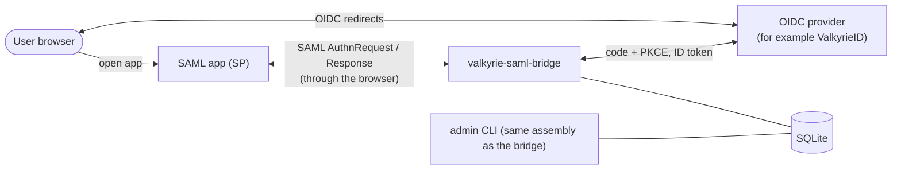
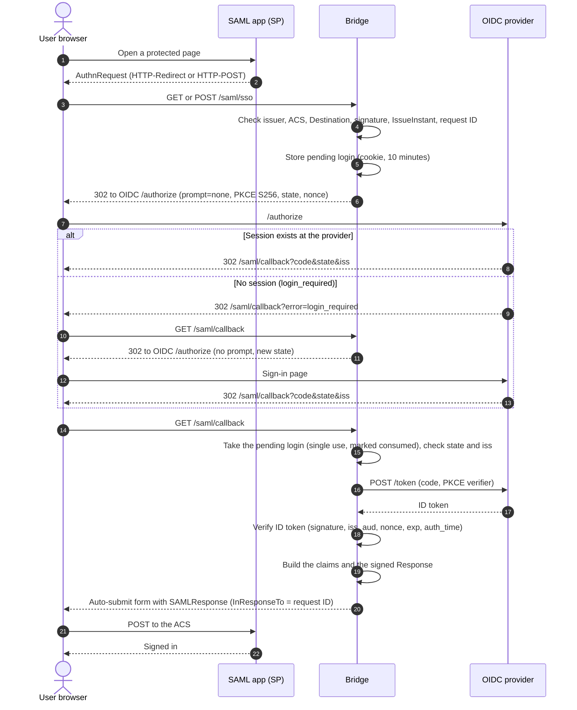
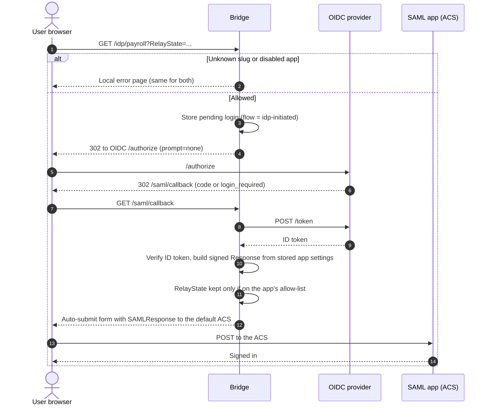
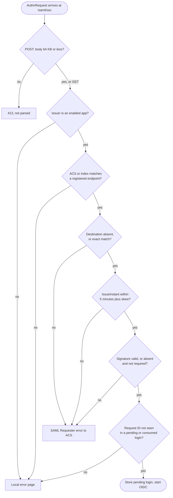
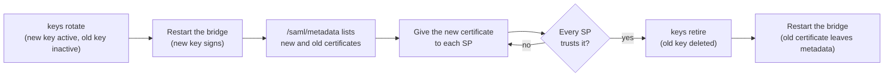

# Login flows

These diagrams show how a sign-in moves through the bridge. The detailed rules are in [SSO](/sso).

## Components

The bridge is the only SAML party the app talks to. The user's OIDC session stays at the provider. The app never sees the provider, and the provider never sees the app.

## SP-initiated sign-in

The user starts at the app. The app sends an AuthnRequest.

`ForceAuthn` sends `prompt=login` instead of `prompt=none`. `IsPassive` never shows the sign-in page, and it gets a `NoPassive` status when there is no session. The callback refuses a `ForceAuthn` sign-in whose `auth_time` is older than the login start minus the clock skew, and sends an `AuthnFailed` error to the ACS.

A pending login is single use. The callback marks it consumed and keeps the row until it expires, so a repeated AuthnRequest ID is refused. A pending login lasts 10 minutes, and a background task deletes expired pending logins every 10 minutes.

For SP-initiated logins, the SP's `RelayState` is echoed unchanged, including in SAML error responses. The app's RelayState allow-list applies only to IdP-initiated logins.

## IdP-initiated sign-in

The user starts at the bridge, from a link such as `https://sso.example.test/idp/payroll`. No AuthnRequest exists, so the response has no `InResponseTo`.

The ACS, audience, and entity ID come only from the app's stored settings. The request can't choose them. Every refusal in this flow shows the local error page, because there is no SAML request to answer.

## Deciding on an AuthnRequest

Refusals go to the local page until the ACS has been validated. After that, a refusal is a SAML error response to the ACS, for SP-initiated logins only (see [SSO](/sso#refusals)).

## Key rotation

Rotation changes the certificate SPs must trust. The old certificate stays published until every SP has the new one.

See [CLI: Rotate the signing key](/cli#rotate-the-signing-key) for the commands.
